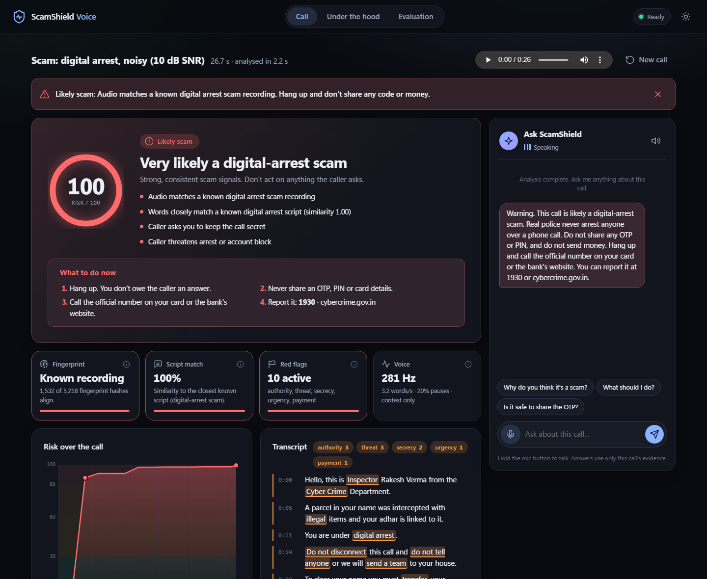

# ScamShield Voice

Listens to a phone call (uploaded recording or live microphone), decides whether it is likely a scam, **shows the evidence**, and **talks to the user**: a spoken warning plus push-to-talk questions ("Why do you think it's a scam?", "What should I do?") answered only from the evidence.

> Course project: MSc AIML, *Speech Processing and Recognition* (MAI522-5), CIA III. Staged and synthetic data only; all names and numbers in the scripts are fictional.

<p align="center"></p>

<table><tr>
<td></td>
<td></td>
<td></td>
</tr></table>


## How it works
| Layer | What it does | Catches |
|---|---|---|
| **L1 Acoustic fingerprint** (from scratch) | own STFT → spectral peaks in 300–3400 Hz → anchor/target hashes → inverted index → **offset-histogram spike** | replayed / robocall audio, even through noise, telephone band, GSM codec, ±5% speed |
| **L2 Script matching** | Whisper transcript → multilingual sentence embeddings vs known scam-script chunks + weighted red-flag lexicon (EN + romanised Hindi) with negation / safe-context handling | new voices and live callers using known scam scripts |
| **L3 Voice cues** (from scratch) | YIN pitch, energy, ZCR, MFCC, pace, pauses | shown as context; not scored yet (no calibration data) |
| **Fusion** | noisy-OR `100·(1 − Π(1 − wᵢsᵢ))`, fingerprint override, safe-context cap → `safe / suspicious / high / scam` + plain-language reasons | |
| **Voice agent** | Gemini or Anthropic, grounded only on the `Evidence` object, number/statistic guard, offline template fallback; cached spoken warnings | |

Every DSP step (pre-emphasis, framing, VAD, STFT, peak picking, hashing, matching, MFCC, YIN) is implemented with NumPy/SciPy and unit-tested against `scipy`/`librosa` references. See `docs/modules/` for per-module notes with formulas (viva prep).

## Results
Full tables and caveats: **[docs/RESULTS.md](docs/RESULTS.md)** (generated from `run_eval` output, never typed by hand). Layer 2 now uses a **learned wording model** (TF-IDF word + character n-grams, logistic regression) trained on 612 generated scam and legitimate scripts (English and Hinglish), see [docs/HOLDOUT.md](docs/HOLDOUT.md). Thresholds were calibrated on a separate generated dev set (through TTS and Whisper); test2 was generated by a *different model with a different prompt*, its SHA-256 was recorded before training, and it was run once.

| | Test (library scripts, other voice) | Holdout (hand-written rewordings) | **Test 2 (locked, new generator)** |
|---|---|---|---|
| Clips | 256 clips | 288 clips | 320 clips |
| Scams caught (upload) | 98.8% (158/160) | 73.1% (117/160) | **92.3% (192/208)** |
| False alarms on legit (upload) | 0% (0/96) | 0.8% (1/128) | **1.8% (2/112)** |
| Wording-model AUC, English / Hinglish | 1.00 / 1.00 | 1.00 / 0.69 | **1.00 / 0.99** |
| Live: scam streams alerted | 100% | 81% | 97% |
| **Live: legit streams that raised an alert** | 0% | 22% | **36%** |
| Live: new-voice alerts within 5 s of the first red-flag phrase | 75% | 98% | 91% |

Before the learned model, the same hand-written holdout scored **11%** scam recall (reworded scams were mostly missed) and the old test split 87.5% with 6.2% false alarms.

**What this means, honestly.**
- **Exact replays:** the fingerprint recognised every known recording through telephone band, GSM, noise down to 5 dB SNR and ±5% speed, with zero false matches on any split.
- **Upload analysis generalises well** to unseen wording, voices and a different generator: about 92% of scams caught with about 2% false alarms on test 2. Weakest type: KYC/OTP (12 of 40 test-2 clips missed); Hinglish KYC/OTP and lottery remain hard on the hand-written holdout.
- **Live mode raises false alerts on genuine calls** (36% of legit streams on test 2, 22% on the holdout; none on the library-script test split). A genuine call can start like a scam (a nurse reporting a child's fall sounds like "relative in trouble" until the reassurance arrives) and the live risk level only ever rises, so an early alert is never withdrawn. The upload path sees the whole call and does not have this problem. This is the most important thing to improve next.
- About two thirds of legit calls on test 2 land in the amber "be careful" band (not flagged), because calibration put the wording floor low.
- Test 2 has no human speech: all audio is TTS, so real-call robustness is untested.

**Other limitations.** Detects *known and similar* scams, not all scams. Live interception of phone calls is not possible on iOS/stock Android; the demo uses speakerphone/microphone or uploaded audio. Not a substitute for calling your bank.

## Quick start
Requires Python 3.11 and **ffmpeg** on PATH.
```bash
python -m venv .venv
.venv\Scripts\activate                 # Linux/macOS: source .venv/bin/activate
pip install -r requirements.txt
cp .env.example .env                   # optional: GEMINI_API_KEY (or ANTHROPIC_API_KEY) for the LLM agent
```
Generate the dataset into `data/` (synthetic TTS + phone-line augmentation; needs internet once):
```bash
cd data && python ../scripts/gen_tts.py && python ../scripts/augment.py && cd ..
python scripts/check_data.py           # expects 136 clean + 952 augmented clips, 16 kHz mono
```
Build the library, calibrate on dev, start:
```bash
python scripts/build_library.py
PYTHONPATH=src python -m scamshield.eval.run_eval --split dev     # Windows PowerShell: $env:PYTHONPATH="src"
python scripts/run_demo.py             # checks setup, starts the server, opens http://localhost:8000
python scripts/run_demo.py --offline   # agent uses offline grounded templates (no LLM calls)
```

## Using it
- **Upload** a recording (wav/mp3/m4a/webm) or drop it anywhere on the page.
- **Play sample**: curated clips; with *as live call* ticked, the sample streams through the live WebSocket path at real-time speed (reliable demo fallback).
- **● Live mic**: real-time analysis from the microphone (use headphones; the mic is muted while the agent speaks).
- **Agent**: hold 🎤 and ask, or type. Toggle 🔊 to mute.
- **Pipeline** tab: offset histogram, stage timings, fusion components. **Results** tab: `summary.json` rendered as tables and plots.

## Evaluate and test
```bash
PYTHONPATH=src python -m scamshield.eval.run_eval --split dev [--quick] [--no-live]   # calibrates + writes artifacts/results/
PYTHONPATH=src python -m scamshield.eval.run_eval --split test                       # ONCE, at the end
python scripts/results_tables.py --split test                                       # Markdown tables for the report
pytest -q                                                                           # data-dependent tests skip without data/
```

## Repo map
```
src/scamshield/
  config.py schemas.py                         shared constants + Pydantic contracts (docs/03)
  audio/        io, preprocess, vad            A
  fingerprint/  spectrogram, peaks, hashing, index, matcher, plots   A
  dsp/          features (MFCC, YIN, energy, ZCR)                    B
  understanding/ stt, script_match, redflags, voice_cues             B
  fusion/       risk                                                 B
  eval/         metrics, run_eval                                    B (+A for Layer 1)
  agent/        llm, prompts, tts, agent                             C
  api/          main, routes, pipeline, viz, session (live), ws      C
web/            index.html, app.js, styles.css, pcm-worklet.js       C
scripts/        gen_tts, augment, check_data, build_library, run_demo, results_tables
docs/           design (00-09), modules/ (per-module notes), RESULTS.md, DEMO.md, architecture.svg
data/, artifacts/   generated locally, gitignored
```

## Team
Owner A: audio + fingerprint · Owner B: features + understanding + fusion + eval · Owner C: agent + API + UI.

## Ethics and privacy
Staged, consented, fictional data only. Live audio is kept in memory for the session and never written to disk. The agent never names or accuses anyone, hedges ("likely"), and always points to the official number and 1930 / cybercrime.gov.in. False-positive risk is measured and reported.
