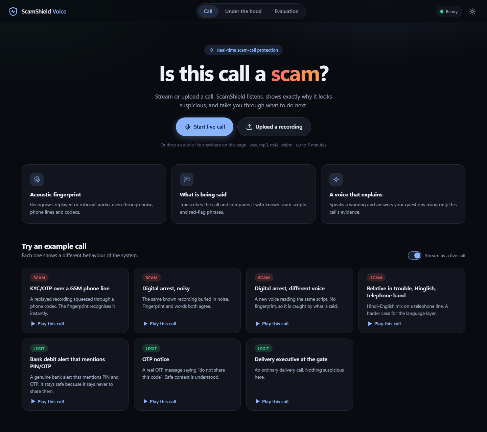
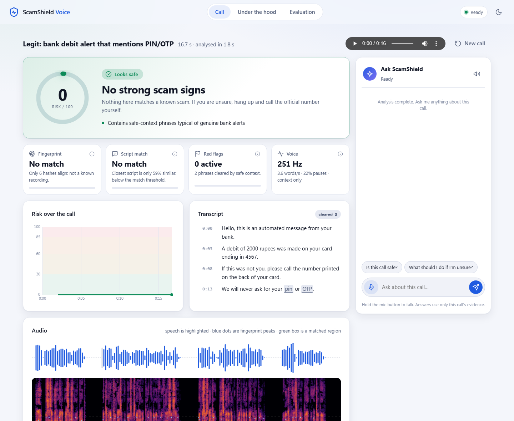
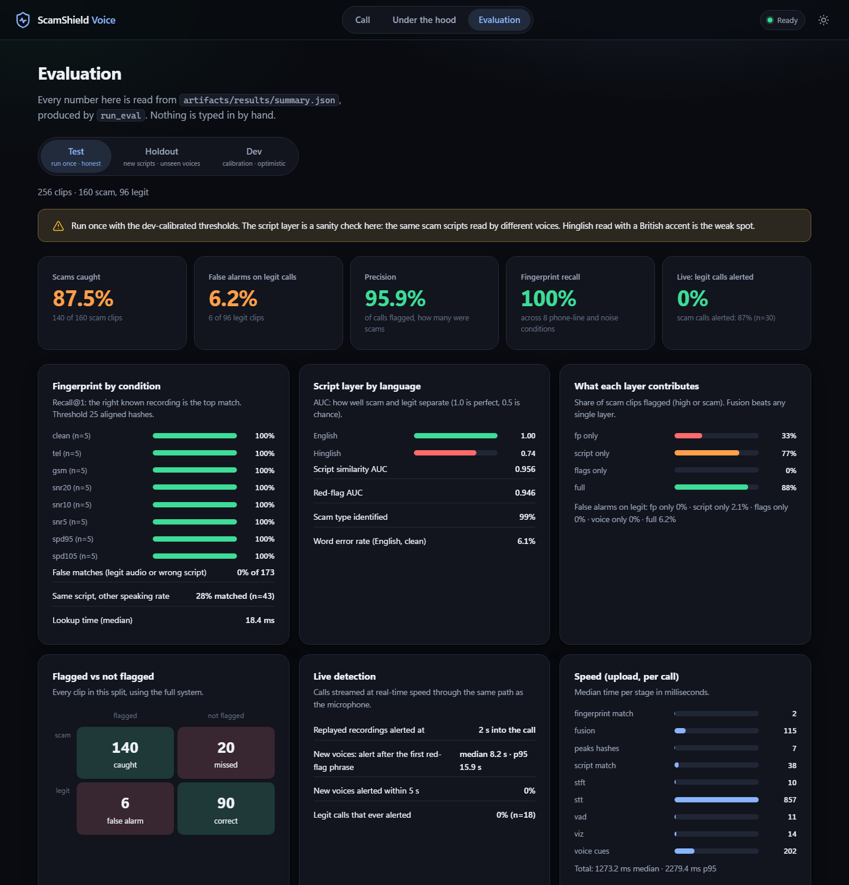
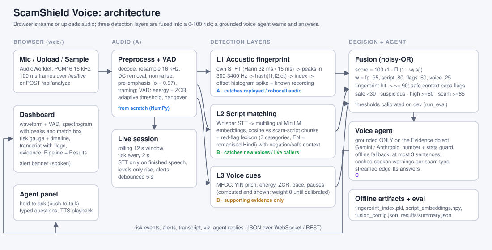

# ScamShield Voice

Listens to a phone call (uploaded recording or live microphone), decides whether it is likely a scam, **shows the evidence**, and **talks to the user**: a spoken warning plus push-to-talk questions ("Why do you think it's a scam?", "What should I do?") answered only from the evidence.

> Course project: MSc AIML, *Speech Processing and Recognition* (MAI522-5), CIA III. Staged and synthetic data only; all names and numbers in the scripts are fictional.

<p align="center"></p>

<table><tr>
<td></td>
<td></td>
<td></td>
</tr></table>



## How it works
| Layer | What it does | Catches |
|---|---|---|
| **L1 Acoustic fingerprint** (from scratch) | own STFT → spectral peaks in 300–3400 Hz → anchor/target hashes → inverted index → **offset-histogram spike** | replayed / robocall audio, even through noise, telephone band, GSM codec, ±5% speed |
| **L2 Script matching** | Whisper transcript → multilingual sentence embeddings vs known scam-script chunks + weighted red-flag lexicon (EN + romanised Hindi) with negation / safe-context handling | new voices and live callers using known scam scripts |
| **L3 Voice cues** (from scratch) | YIN pitch, energy, ZCR, MFCC, pace, pauses | shown as context; not scored yet (no calibration data) |
| **Fusion** | noisy-OR `100·(1 − Π(1 − wᵢsᵢ))`, fingerprint override, safe-context cap → `safe / suspicious / high / scam` + plain-language reasons | |
| **Voice agent** | Gemini or Anthropic, grounded only on the `Evidence` object, number/statistic guard, offline template fallback; cached spoken warnings | |

Every DSP step (pre-emphasis, framing, VAD, STFT, peak picking, hashing, matching, MFCC, YIN) is implemented with NumPy/SciPy and unit-tested against `scipy`/`librosa` references. See `docs/modules/` for per-module notes with formulas (viva prep).

## Results
Full tables, caveats and per-split detail: **[docs/RESULTS.md](docs/RESULTS.md)** (generated from `run_eval` output, never typed by hand). Three splits, from most to least flattering:

| | Dev (thresholds tuned here) | Test (run once) | **Holdout (new wording, unseen voices)** |
|---|---|---|---|
| What it tests | library scripts, 2 voices | library scripts, 1 other voice | **10 reworded scam scripts + 8 new, tricky legit scripts, 4 unseen voices** ([how it was built](docs/HOLDOUT.md)) |
| Scams caught (recall) | 97% | 87.5% | **11%** |
| False alarms on legit | 0% | 6.2% | 0% |
| Fingerprint false matches | 0 / 346 | 0 / 173 | 0 / 288 |
| Script-similarity AUC (English / Hinglish) | 1.0 / 1.0 | 1.0 / 0.75 | **0.86 / 0.63** |

**What this means, honestly.**
- **Exact audio replays are caught reliably:** the fingerprint recognised every known recording through telephone band, GSM, noise down to 5 dB SNR and ±5% speed, with zero false matches on legit or unrelated audio.
- **Scripts close to the library are caught** (dev and test), including by other voices.
- **Genuinely reworded scams mostly are not.** On the holdout, reworded scams score about 0.62 similarity to the library (55% fall below the calibrated match floor) against 0.54 for legit calls, and the keyword lexicon misses paraphrases ("tell me that code" instead of "OTP"). Only the reworded digital-arrest script was reliably rated *high*. This is a limit of a small library plus a keyword lexicon, not just of the thresholds, and the demo must not promise otherwise.
- **Hinglish** is weaker still, and British-accented Hinglish defeats Whisper.
- **Live:** fingerprint replays alert about 2 s into the call; for new voices on library scripts the median is 8.2 s after the first red-flag phrase (test split).
- Upload analysis takes 1.3 s median per call (2.3 s p95).

**Other limitations.** Detects *known and similar* scams, not all scams. The holdout scripts were written by the same assistant that wrote the lexicon; independent human-written scripts and recordings are still needed. Live interception of phone calls is not possible on iOS/stock Android; the demo uses speakerphone/microphone or uploaded audio. Not a substitute for calling your bank.

## Quick start
Requires Python 3.11 and **ffmpeg** on PATH.
```bash
python -m venv .venv
.venv\Scripts\activate                 # Linux/macOS: source .venv/bin/activate
pip install -r requirements.txt
cp .env.example .env                   # optional: GEMINI_API_KEY (or ANTHROPIC_API_KEY) for the LLM agent
```
Generate the dataset into `data/` (synthetic TTS + phone-line augmentation; needs internet once):
```bash
cd data && python ../scripts/gen_tts.py && python ../scripts/augment.py && cd ..
python scripts/check_data.py           # expects 136 clean + 952 augmented clips, 16 kHz mono
```
Build the library, calibrate on dev, start:
```bash
python scripts/build_library.py
PYTHONPATH=src python -m scamshield.eval.run_eval --split dev     # Windows PowerShell: $env:PYTHONPATH="src"
python scripts/run_demo.py             # checks setup, starts the server, opens http://localhost:8000
python scripts/run_demo.py --offline   # agent uses offline grounded templates (no LLM calls)
```

## Using it
- **Upload** a recording (wav/mp3/m4a/webm) or drop it anywhere on the page.
- **Play sample**: curated clips; with *as live call* ticked, the sample streams through the live WebSocket path at real-time speed (reliable demo fallback).
- **● Live mic**: real-time analysis from the microphone (use headphones; the mic is muted while the agent speaks).
- **Agent**: hold 🎤 and ask, or type. Toggle 🔊 to mute.
- **Pipeline** tab: offset histogram, stage timings, fusion components. **Results** tab: `summary.json` rendered as tables and plots.

## Evaluate and test
```bash
PYTHONPATH=src python -m scamshield.eval.run_eval --split dev [--quick] [--no-live]   # calibrates + writes artifacts/results/
PYTHONPATH=src python -m scamshield.eval.run_eval --split test                       # ONCE, at the end
python scripts/results_tables.py --split test                                       # Markdown tables for the report
pytest -q                                                                           # data-dependent tests skip without data/
```

## Repo map
```
src/scamshield/
  config.py schemas.py                         shared constants + Pydantic contracts (docs/03)
  audio/        io, preprocess, vad            A
  fingerprint/  spectrogram, peaks, hashing, index, matcher, plots   A
  dsp/          features (MFCC, YIN, energy, ZCR)                    B
  understanding/ stt, script_match, redflags, voice_cues             B
  fusion/       risk                                                 B
  eval/         metrics, run_eval                                    B (+A for Layer 1)
  agent/        llm, prompts, tts, agent                             C
  api/          main, routes, pipeline, viz, session (live), ws      C
web/            index.html, app.js, styles.css, pcm-worklet.js       C
scripts/        gen_tts, augment, check_data, build_library, run_demo, results_tables
docs/           design (00-09), modules/ (per-module notes), RESULTS.md, DEMO.md, architecture.svg
data/, artifacts/   generated locally, gitignored
```

## Team
Owner A: audio + fingerprint · Owner B: features + understanding + fusion + eval · Owner C: agent + API + UI.

## Ethics and privacy
Staged, consented, fictional data only. Live audio is kept in memory for the session and never written to disk. The agent never names or accuses anyone, hedges ("likely"), and always points to the official number and 1930 / cybercrime.gov.in. False-positive risk is measured and reported.
