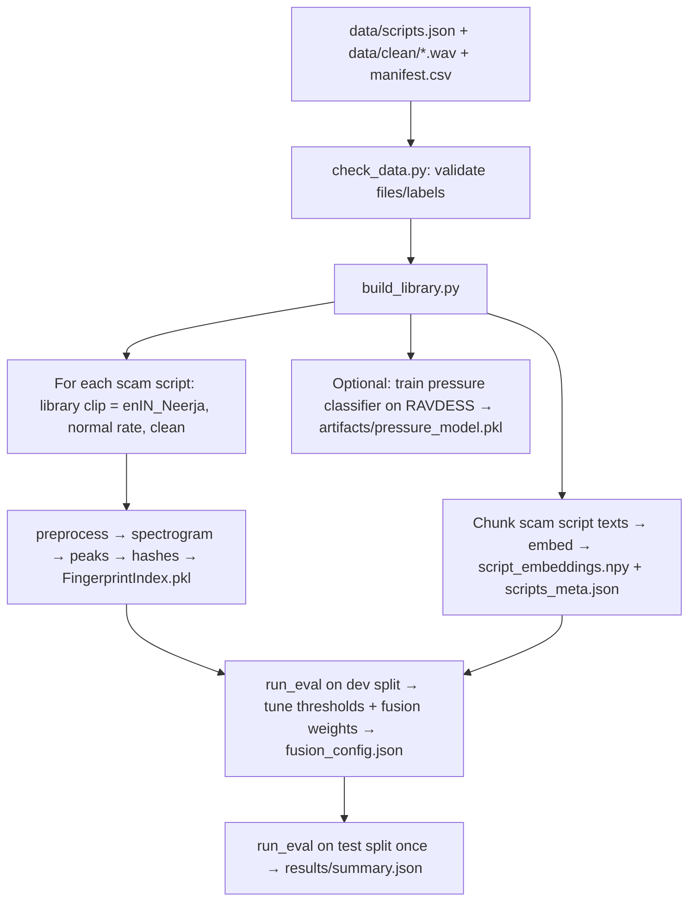
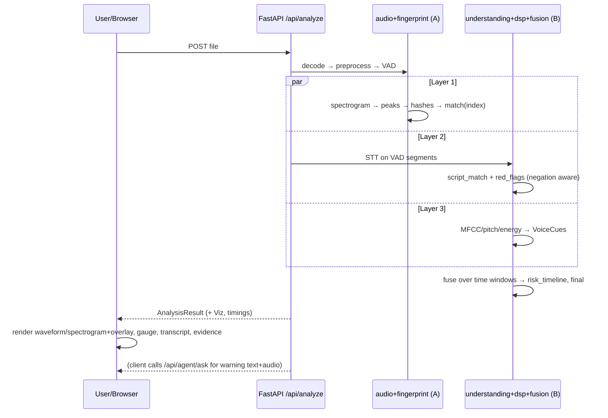
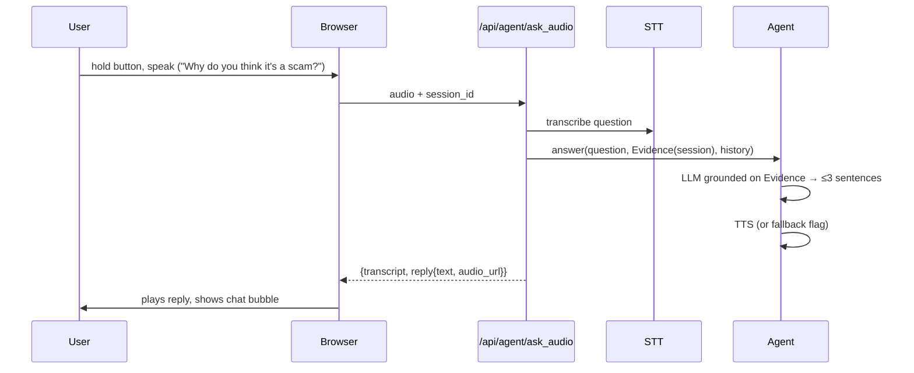
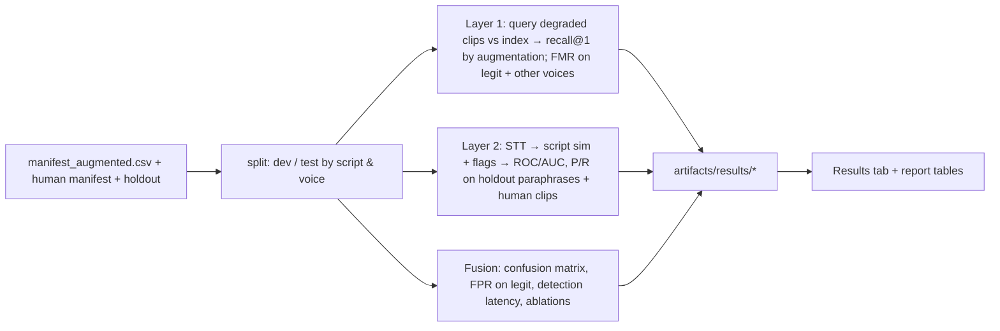

# 04 — Flows

## F1. Offline build (once, and after any data/library change)


## F2. Upload analysis (MVP path)


## F3. Live call (streaming)
```mermaid
sequenceDiagram
  participant M as Mic/AudioWorklet
  participant WS as /ws/live
  participant S as Session (rolling 12 s buffer)
  participant P as Pipeline (A+B)
  participant AG as Agent (C)
  M->>WS: PCM16 16k frames (100 ms)
  WS->>S: append
  loop every ~2 s or on VAD segment end
    S->>P: window audio
    P->>P: fingerprint(window) ; STT(new segments) ; update script/flags ; voice cues ; fuse
    P-->>WS: viz / transcript / fp_match / risk
    alt level increased
      P->>AG: warn(Evidence)
      AG-->>WS: alert(message, audio_url)
    end
  end
  M->>WS: {"type":"stop"}
  WS->>P: finalize full-call analysis
  WS-->>M: final AnalysisResult
```

## F4. Voice Q&A (push-to-talk)


## F5. Evaluation


## Risk level state machine (live)
`safe → suspicious → high → scam`. Level can only go up within a call unless score stays below the lower threshold for ≥ 10 s (then step down one level). Alerts fire on upward transitions, debounced ≥ 5 s. Fingerprint hit above threshold jumps straight to `scam`.
